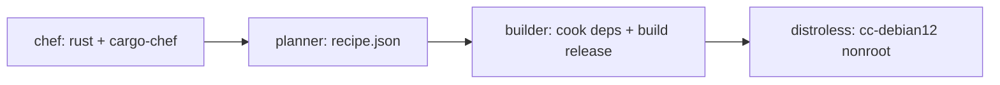

# Midjourney prompts — rust-railway-minimal article

Prompts for the two suggested images. Midjourney renders *illustration*, not legible text or precise diagrams — so these lean abstract/minimal. For the stage flow, use the Mermaid diagram below instead; it renders as a real diagram.

## 1. Hero / cover

```
minimal flat illustration, a compact rust-colored container shrinking to a tiny box while three meters for CPU, memory, and egress drop to near zero, clean negative space, dark navy background, subtle orange and violet accent, isometric, no text --ar 16:9 --style raw
```

## 2. Inline — the multi-stage build (prefer the diagram)

Midjourney prompt (illustrative only):

```
schematic of a four-stage assembly line, four rounded boxes connected by arrows, one box highlighted in orange as a cached layer, industrial minimal flat style, dark background, no text --ar 3:2 --style raw
```

Actual diagram (drop into the article as a code block):



## Notes

- `--style raw` keeps Midjourney from adding its default glossy "AI look".
- Regenerate with `--no text, labels, letters` if text artifacts appear.
- For a precise, maintainable stage diagram, the Mermaid block is the right tool — Midjourney is for the hero art only.
